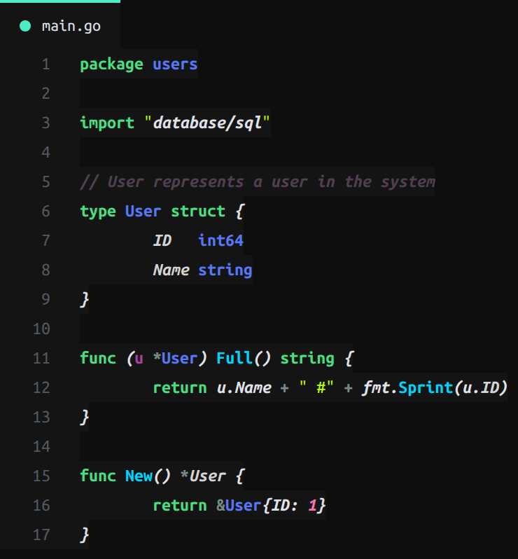
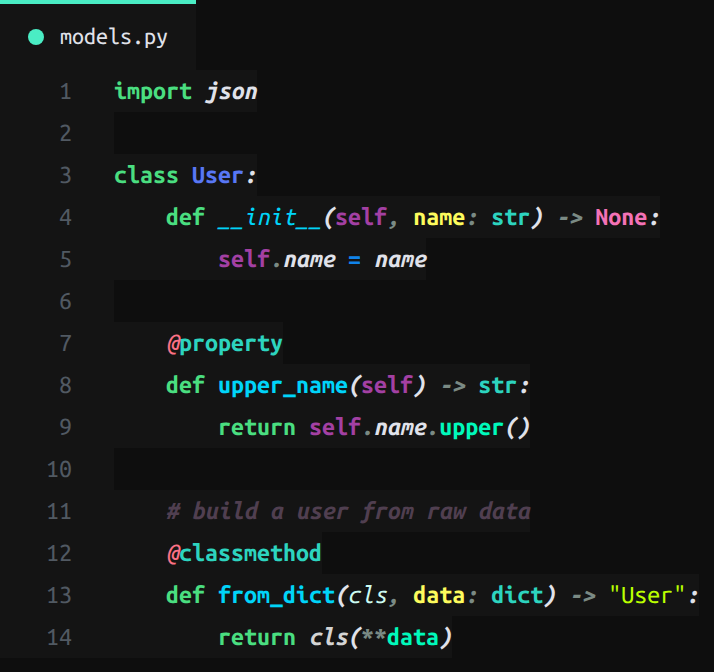
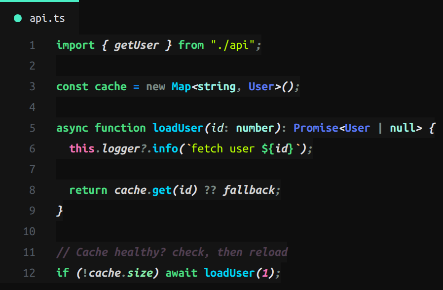
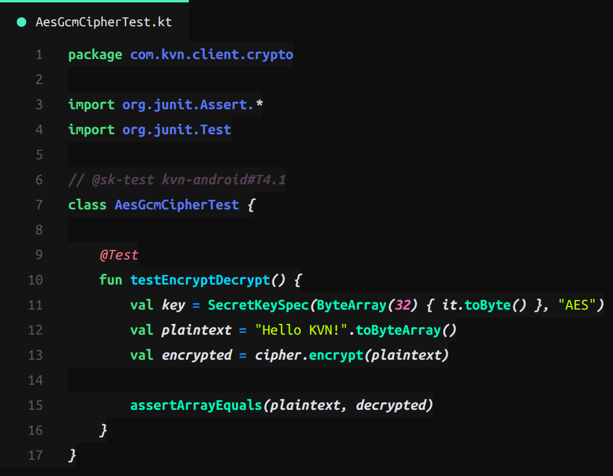
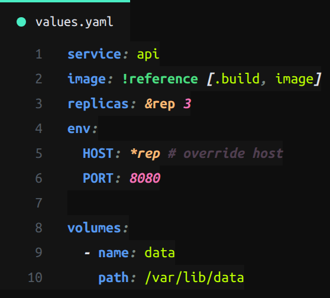

# BZDVDN Dark Green

Custom VS Code theme based on **MintShot Dark Green** with personal overrides baked in.

## Preview

Screenshots are rendered with the real TextMate engine (`vscode-textmate` + `oniguruma`) using the actual grammars (Go, Python/MagicPython, TypeScript, YAML, Kotlin) and this theme's token rules — so they match what you see in the editor.

### Go



### Python



### TypeScript / JavaScript



### Kotlin



### YAML



## What's inside

- Full MintShot Dark Green palette (colors + tokenColors + semanticTokenColors)
- Custom overrides from `editor.tokenColorCustomizations` baked directly into the theme:
  - comparison/assignment operators: `#1087f0fd` bold
  - functions and classes: `#00d4f9` bold
  - `meta.function-call`: `#00f9bb` bold
  - python `self`: `#a340a3` bold
  - modules/types/classes: `#5877f4` bold
  - python function parameters: `#fdfb5d` bold
  - HTML tags: `#5699f0` bold
  - strings: `#bbff00`
- **Comments unified across ALL languages**: `#503f50` bold + italic (previously Go had its own color, everything else a different one)
- Window title bar follows the theme's dark palette (`#0e0e0e`)

### Language-specific tweaks

- **Go**: package name `#5877f4` bold; receiver param `#a340a3` bold (like Python `self`)
- **Python**: magic methods (`__init__`, `__str__`) italic
- **Kotlin**: package/import names `#5877f4` bold; annotations (`@Test`, `@Before`) `#FB7185` italic like Python decorators; function calls `#00f9bb` bold (needs the Kotlin extension installed, e.g. `fwcd.kotlin`)
- **JS/TS**: `this`/`super`/`arguments` `#F472B6` bold; `?.`, `?:`, `...` operators in the blue operator set
- **YAML**: anchors `&name` and aliases `*alias` warm `#FDBA74`

## Installation

### Option 1 — build a .vsix and install on any device

```bash
npm install -g @vscode/vsce   # once
npm run package               # produces bzdvdn-theme-1.0.0.vsix
```

In VS Code: `Extensions` → `...` (More Actions) → **Install from VSIX...** and pick the file.
Or from the terminal:

```bash
code --install-extension bzdvdn-theme-1.0.0.vsix
```

### Option 2 — copy the folder into extensions

Copy this project to `~/.vscode/extensions/bzdvdn.bzdvdn-theme-1.0.0/` and restart VS Code.

## Activation

`Ctrl+K Ctrl+T` → pick **BZDVDN Dark Green**.

## Difference from the old settings.json setup

Everything that used to live in `editor.tokenColorCustomizations` for `[MintShot Dark Green]` now lives inside the theme itself — those rules no longer need `settings.json`.

It is recommended to keep `"editor.semanticHighlighting.enabled": false` (otherwise the theme's semantic tokens may override TextMate rules).